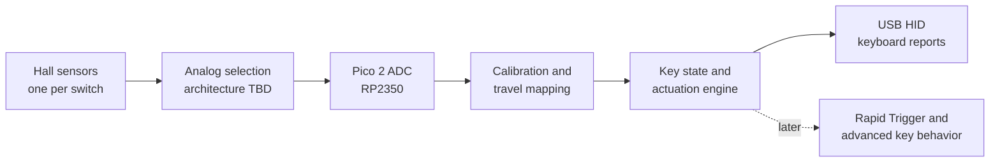
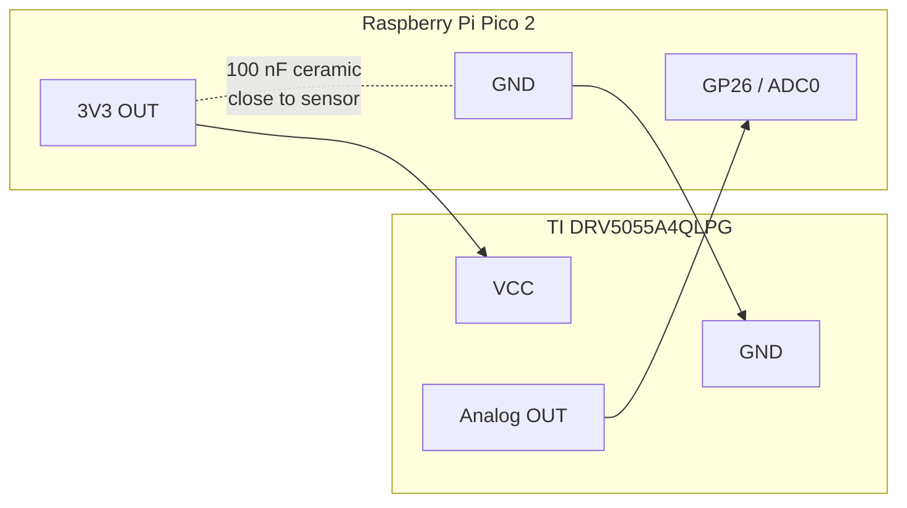

# Custom Hall Effect Keyboard

An in-progress, from-scratch 75% ANSI Hall Effect keyboard project. The goal is to develop the electronics, firmware, sensing algorithms, and mechanical design as small, testable milestones.

## Project overview

The planned keyboard uses Gateron Magnetic Jade Pro switches, one analog Hall sensor per key, and a Raspberry Pi Pico 2 (RP2350) for sensing and USB HID. Planned firmware features include adjustable actuation, per-key calibration, Rapid Trigger, and later configurable multi-action and opposing-direction behavior.

The first hardware experiment is a single sensor and switch. We will measure the sensor response and switch travel before selecting a full-keyboard scanning architecture or committing to a PCB. The analog multiplexer approach shown below is a candidate for evaluation, not a selected design.

## Proposed keyboard layout

The target is a custom 75% ANSI layout based on the preferred KLE Revision 1.0 arrangement. It has dedicated arrow keys, a 2u x 2u top-right reserved space for a 20 mm rotary knob, and a 2.5u right Shift. The knob reservation is not a key or encoder footprint yet. The final physical key count still needs to be checked from the finished layout before PCB design.

| Row | Layout |
| --- | --- |
| Function | Esc; F1-F4; F5-F8; F9-F12; 2u x 2u knob reservation at top-right |
| Number | Grave, 1-0, -, =, 1.75u Backspace |
| Q row | 1.5u Tab, Q-P, [, ], 1.25u backslash, Ins, Home |
| Home row | 1.75u Caps, A-L, ;, ', 2u Enter, Del, PgDn |
| Shift row | 2.25u left Shift, Z-M, comma, period, slash, 2.5u right Shift, Up, PgUp |
| Bottom row | 1.25u Ctrl, 1.25u Win, 1.25u Alt, 6.25u Space, 1.25u Alt, 1.25u Fn, 1.25u Ctrl, Left, Down, Right |

KLE layout seed (the knob is a placeholder tile):

```javascript
["Esc",{x:0.5},"F1","F2","F3","F4",{x:0.5},"F5","F6","F7","F8",{x:0.5},"F9","F10","F11","F12",{x:0.5,a:7,w:2,h:2},"Knob"],
[{y:0.25,a:4},"`","1","2","3","4","5","6","7","8","9","0","-","=",{w:1.75},"Backspace"],
[{w:1.5},"Tab","Q","W","E","R","T","Y","U","I","O","P","[","]",{w:1.25},"\\","Ins","Home"],
[{w:1.75},"Caps","A","S","D","F","G","H","J","K","L",";","'",{w:2},"Enter","Del","PgDn"],
[{w:2.25},"Shift","Z","X","C","V","B","N","M",",",".","/",{w:2.5},"Shift","Up","PgUp"],
[{w:1.25},"Ctrl",{w:1.25},"Win",{w:1.25},"Alt",{w:6.25},"Space",{w:1.25},"Alt",{w:1.25},"Fn",{w:1.25},"Ctrl","Left","Down","Right"]
```

## System architecture sketch

This is the current functional plan for the complete keyboard, not a finalized electrical schematic. The sensor interface, ADC throughput, filtering latency, and multiplexing strategy still need measurement and design review.



## One-switch prototype wiring

The following is the proposed breadboard connection for the initial sensor test. **It is not yet a verified, build-ready schematic:** confirm the exact DRV5055A4QLPG package pinout and electrical limits against the TI datasheet, and confirm Pico 2 ADC limits, before wiring or applying power. Do not infer the sensor pin order from a generic TO-92 drawing.



| Pico 2 connection | Proposed sensor connection | Status |
| --- | --- | --- |
| 3V3(OUT) | VCC | Verify sensor supply range and package pinout first |
| GND | GND | Common ground |
| GP26 / ADC0 | Analog OUT | Verify output range against ADC input limits |
| — | 100 nF from VCC to GND, close to sensor | Decoupling capacitor |

The first experiment will establish a stationary baseline, move a magnet relative to the sensor, and record ADC readings. Once the Jade Pro switch is available, an adjustable fixture will measure readings across physical switch travel. Monotonicity, noise, repeatability, and usable resolution must be measured before normalizing sensor values to key travel.

## Repository contents

```text
.
├── CMakeLists.txt          # Top-level Pico SDK configuration
├── firmware/
│   ├── CMakeLists.txt      # Firmware target configuration
│   └── src/
│       └── main.cpp        # Minimal Pico 2 onboard LED blink program
├── README.md               # Project overview, layout, schematics, and build steps
├── pico-sdk/               # Local SDK checkout; ignored by Git
├── .tooling/               # Local CMake, Ninja, and Arm compiler; ignored by Git
└── build/                  # Generated build output; ignored by Git
```

Only the project files are tracked. The Pico SDK, compiler, and generated build output are local dependencies and are excluded by `.gitignore`.

## Current status

- **Software foundation:** a minimal C++ program compiles for the Pico 2 / RP2350 Arm target.
- **Firmware behavior:** the program blinks the board's default onboard LED.
- **Sensor circuit:** proposed only; datasheet pinout and electrical checks are still required before breadboarding.
- **USB and UF2:** USB is not enabled in this first program. The current build skips Picotool, so it produces an ELF file but not a flashable UF2.
- **Full keyboard schematic and PCB:** not designed yet; the scanning architecture remains open pending sensor measurements and timing calculations.

## Build on Windows

The local development setup used for the current build has CMake under `.tooling/cmake-fresh/`, Ninja under `.tooling/python/`, the Arm GNU bare-metal toolchain under `.tooling/arm/bin/`, and the Pico SDK at `pico-sdk/`.

```powershell
$env:Path = (Resolve-Path '.tooling\cmake-fresh\cmake\data\bin').Path + ';' + (Resolve-Path '.tooling\python\bin').Path + ';' + (Resolve-Path '.tooling\arm\bin').Path + ';' + $env:Path
$env:PICO_SDK_PATH = (Resolve-Path 'pico-sdk').Path
cmake -S . -B build -G Ninja -DPICO_BOARD=pico2 -DPICO_NO_PICOTOOL=1
cmake --build build
```

The successful build artifact is `build/kb_from_scratch.elf`. To produce a UF2 and flash the board, install/configure Picotool, rebuild without `PICO_NO_PICOTOOL=1`, then hold **BOOTSEL** while connecting the Pico 2 and copy the resulting UF2 to its `RPI-RP2` drive.

## Roadmap

1. Finish the software foundation and make the development setup reproducible.
2. Verify the official TI sensor datasheet details and prepare a checked breadboard schematic.
3. Read and log one sensor, then characterize the Jade Pro switch over measured travel.
4. Develop calibration, travel mapping, adjustable actuation, and Rapid Trigger against recorded traces.
5. Calculate scan timing, choose the full sensing architecture, and design the keyboard schematic, PCB, and enclosure.

## Pre-arrival checklist

- [x] Create the GitHub repository and initial firmware directory structure.
- [x] Install VS Code and the Pico SDK build toolchain; compile the Pico 2 LED firmware.
- [ ] Design the single-switch mechanical test fixture in CAD.
- [ ] Write a Python script to simulate Hall sensor readings.
- [ ] Implement normalized key travel and adjustable actuation logic.
- [ ] Implement and evaluate Rapid Trigger with simulated data.
- [ ] Review the DRV5055 datasheet and prepare the verified breadboard schematic.
